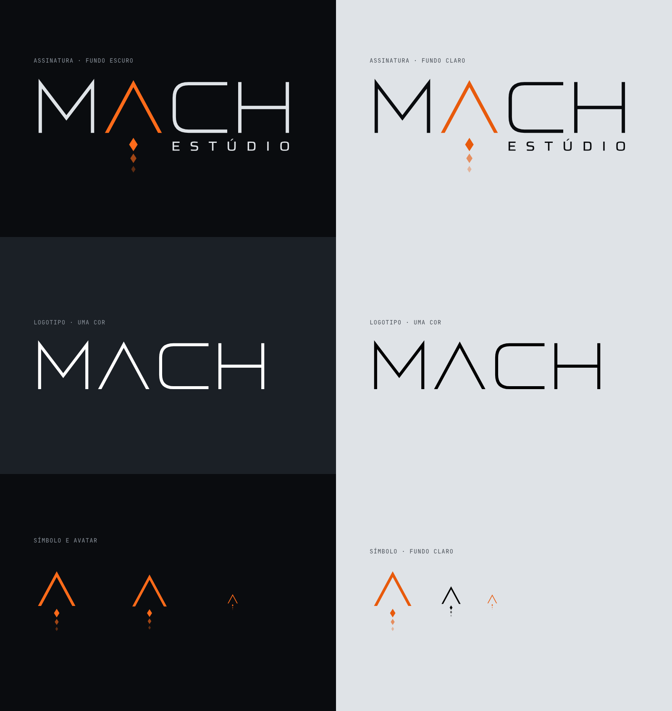

# MACH Estúdio — logo

Mach é a medida de velocidade dos jatos. O "A" é um **Λ** laranja (asa delta / cone de Mach) e os três losangos sob ele são os
**diamantes de choque** que aparecem no escapamento de um jato em pós-combustão.



## Arquivos

| Peça | Uso | Arquivos |
|---|---|---|
| Assinatura | Uso principal: logotipo + diamantes + descritor ESTÚDIO | `svg/assinatura-{escuro,claro,branco,preto}.svg` · `png/…` (2400 px) |
| Logotipo | Quando o espaço é horizontal e curto (cabeçalho do site, rodapé) | `svg/logotipo-*.svg` · `png/…` |
| Símbolo | Λ + diamantes, para espaços pequenos | `svg/simbolo-*.svg` · `png/…` |
| Avatar | Foto de perfil (Instagram, LinkedIn, WhatsApp) | `svg/avatar.svg` · `png/avatar-1080.png` |
| Favicon | Ícone do site | `png/favicon-512.png` |

`escuro` = para fundos escuros (letras alumínio, acento laranja) · `claro` = para fundos claros ·
`branco`/`preto` = uma cor só (gravação, carimbo, fundos fotográficos).

## Cores

| Nome | Hex | Uso |
|---|---|---|
| Estratosfera | `#0A0C0F` | Fundo escuro |
| Titânio | `#1B2026` | Superfícies |
| Alumínio | `#DFE3E7` | Letras no escuro / fundo claro |
| Névoa | `#8A929B` | Textos de apoio |
| Laranja de teste | `#FF6B1A` (escuro) · `#E85A0C` (claro) | Só o Λ, os diamantes e um destaque por tela |

## Regras rápidas

- Respiro mínimo em volta do logo: a altura do "H" dividida por 2.
- Não girar, distorcer, contornar, aplicar sombra ou trocar as cores do Λ.
- Tamanho mínimo: logotipo com 80 px de largura; abaixo disso, use o símbolo.
- Tipografia de apoio: Saira (títulos e marcações), Hanken Grotesk (texto), JetBrains Mono (números).

## Gerar de novo

```bash
pip install fonttools
python3 marca-mach/gerar_logo.py     # SVGs + geometria do vídeo (video-anuncio/src/logoMach.js)
node marca-mach/exportar_png.mjs     # PNGs + folha de marca (requer Playwright)
```

Fonte do descritor: Saira Expanded Medium (SIL Open Font License), já convertida em curvas nos SVGs.
